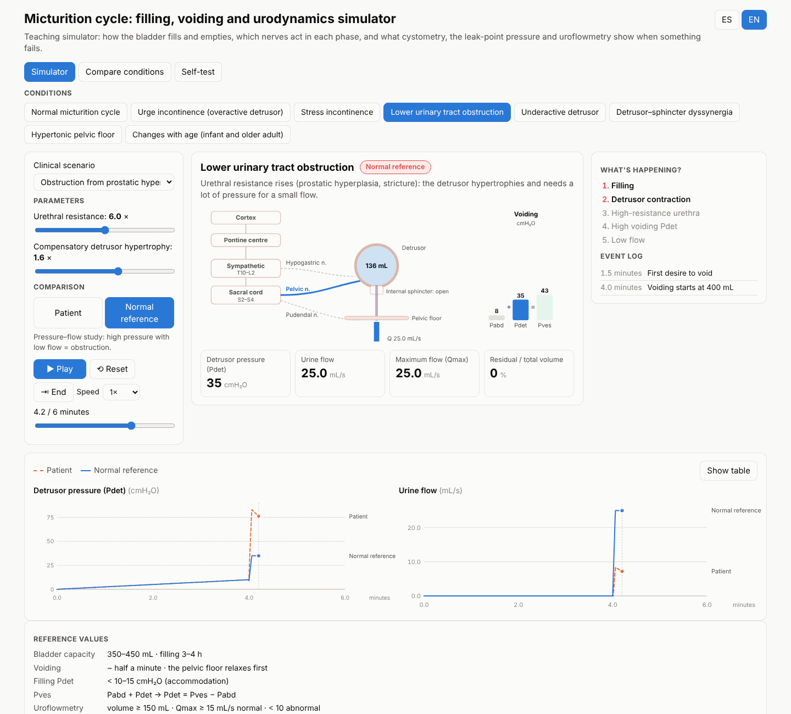

# Micturition cycle: filling, voiding and urodynamics

**Ciclo miccional: llenado, vaciado y urodinámica** — interactive teaching simulator (Spanish / English).

**Live demo:** https://ferasmed-dev.github.io/micturition-cycle/ · English: https://ferasmed-dev.github.io/micturition-cycle/?lang=en



One bladder, run as a urodynamic study: it fills at a fixed rate (cystometry), then voids (pressure–flow and uroflowmetry). The diagram shows the cortex, pontine centre and spinal centres, which nerve fires in each phase, the sphincters and pelvic floor, the urine stream and live Pabd + Pdet = Pves bars. Each condition can be compared with a **normal reference cycle** drawn on the same axes (this topic has no treatments, so the comparison arm is the healthy bladder).

## What it shows

| Condition | Key parameters | What the study shows |
|---|---|---|
| Normal cycle | capacity, filling rate | flat filling pressure, bell-shaped flow, Qmax 25 mL/s, residual ≈ 0 |
| Urge incontinence (overactive detrusor) | threshold volume, wave amplitude, idiopathic vs neurogenic | involuntary contractions, leaks, reduced functional capacity |
| Stress incontinence | ALPP, cough pressure | leaks on coughing with flat Pdet; ALPP > 60 / < 60 / < 30 |
| Outlet obstruction | urethral resistance, detrusor hypertrophy | high Pdet, Qmax < 10 |
| Underactive detrusor | contractility, contraction duration | low Pdet, Qmax < 10, residual > 20 % |
| Detrusor–sphincter dyssynergia | sphincter closures, strength | interrupted flow, high Pdet, active EMG, residual |
| Hypertonic pelvic floor | tone, relaxation time | delayed start, weak flow |
| Age (infant / older adult) | stage | reflex voiding at ~80 mL / lower capacity with overactivity |

Every entity offers:

- a **schematic** that shows the mechanism live and highlights where the disorder acts;
- **sliders and choices** for the parameters that drive it;
- a **patient vs normal reference** comparison drawn on the same chart (dashed = patient, solid = normal);
- a **"¿Qué está pasando?"** panel that lights up each step of the mechanism as it happens, plus an **event log**;
- gauges with reference ranges, a **data-table view** of every chart, a **compare** tab with all entities side by side and a **self-test** tab.

## Curriculum fit

For students and teachers at any Spanish medical faculty.

- **Module (Orden ECI/332/2008):** Módulo III, *Formación clínica humana* (with support from Módulo II for physiology and pathology).
- **Typical subjects:** Fisiología (renal / lower urinary tract), Fisiopatología, Patología médica / Urología, Nefrología y Urología, Geriatría.
- **MIR:** recurrent (filling vs voiding disorders, urodynamic patterns, ALPP, Qmax and residual cut-offs, innervation).

## For teachers

Every scenario has a deep link you can project or share. Add `&lang=en` for English.

| Preset | Scenario (EN) | Expected result (patient) | Link |
|---|---|---|---|
| `adulto_sano` | Healthy adult | Voids at 400 mL (4 min): Qmax 25 mL/s, residual ≈ 2 mL | [ES](https://ferasmed-dev.github.io/micturition-cycle/?preset=adulto_sano) · [EN](https://ferasmed-dev.github.io/micturition-cycle/?preset=adulto_sano&lang=en) |
| `vejiga_pequena` | Capacity 300 mL | Same pattern, voiding at 300 mL | [ES](https://ferasmed-dev.github.io/micturition-cycle/?preset=vejiga_pequena) · [EN](https://ferasmed-dev.github.io/micturition-cycle/?preset=vejiga_pequena&lang=en) |
| `urgencia_idiopatica` | Urgency without neurological disease | First involuntary contraction at ~230 mL, leak, urgent void at ~300 mL | [ES](https://ferasmed-dev.github.io/micturition-cycle/?preset=urgencia_idiopatica) · [EN](https://ferasmed-dev.github.io/micturition-cycle/?preset=urgencia_idiopatica&lang=en) |
| `hiperreflexia_neurologica` | Hyperreflexia in neurological disease | Earlier, larger waves (Pdet ~80), leaks, voids at ~185 mL | [ES](https://ferasmed-dev.github.io/micturition-cycle/?preset=hiperreflexia_neurologica) · [EN](https://ferasmed-dev.github.io/micturition-cycle/?preset=hiperreflexia_neurologica&lang=en) |
| `hipermovilidad_posparto` | Stress incontinence after childbirth | ALPP 85: small leaks with strong coughs (~8 mL), flat Pdet | [ES](https://ferasmed-dev.github.io/micturition-cycle/?preset=hipermovilidad_posparto) · [EN](https://ferasmed-dev.github.io/micturition-cycle/?preset=hipermovilidad_posparto&lang=en) |
| `deficit_esfinteriano` | Intrinsic sphincter deficiency | ALPP 45: larger leaks with every cough (~21 mL) | [ES](https://ferasmed-dev.github.io/micturition-cycle/?preset=deficit_esfinteriano) · [EN](https://ferasmed-dev.github.io/micturition-cycle/?preset=deficit_esfinteriano&lang=en) |
| `esfinter_muy_debil` | Very weak sphincter | ALPP 25: leaks even with soft coughs | [ES](https://ferasmed-dev.github.io/micturition-cycle/?preset=esfinter_muy_debil) · [EN](https://ferasmed-dev.github.io/micturition-cycle/?preset=esfinter_muy_debil&lang=en) |
| `hbp_obstructiva` | Obstruction from prostatic hyperplasia | Pdet ~83 cmH₂O, Qmax 8 mL/s, residual 17 % | [ES](https://ferasmed-dev.github.io/micturition-cycle/?preset=hbp_obstructiva) · [EN](https://ferasmed-dev.github.io/micturition-cycle/?preset=hbp_obstructiva&lang=en) |
| `neuropatia_diabetica` | Diabetic neuropathy | Pdet ~18, Qmax 8 mL/s, residual 44 % | [ES](https://ferasmed-dev.github.io/micturition-cycle/?preset=neuropatia_diabetica) · [EN](https://ferasmed-dev.github.io/micturition-cycle/?preset=neuropatia_diabetica&lang=en) |
| `lesion_medular` | Spinal cord injury with dyssynergia | Interrupted flow, Pdet ~76, Qmax 15, residual 39 % | [ES](https://ferasmed-dev.github.io/micturition-cycle/?preset=lesion_medular) · [EN](https://ferasmed-dev.github.io/micturition-cycle/?preset=lesion_medular&lang=en) |
| `suelo_tenso` | Pelvic floor that does not relax | Delayed start, Qmax 8 mL/s | [ES](https://ferasmed-dev.github.io/micturition-cycle/?preset=suelo_tenso) · [EN](https://ferasmed-dev.github.io/micturition-cycle/?preset=suelo_tenso&lang=en) |
| `lactante` | Infant | Reflex void at 80 mL without first desire | [ES](https://ferasmed-dev.github.io/micturition-cycle/?preset=lactante) · [EN](https://ferasmed-dev.github.io/micturition-cycle/?preset=lactante&lang=en) |
| `anciano_urgencia` | Older woman with urgency | Involuntary waves from 180 mL, leak, void at ~250 mL | [ES](https://ferasmed-dev.github.io/micturition-cycle/?preset=anciano_urgencia) · [EN](https://ferasmed-dev.github.io/micturition-cycle/?preset=anciano_urgencia&lang=en) |

You can also open a single entity with `?entity=<key>` (keys are listed in `src/model.js`).

## Model

- **Filling:** volume rises at the filling rate (100 mL/min fast-fill, so the void stays visible); `Pdet = V / compliance` (compliance 40 mL/cmH₂O → < 10 cmH₂O at 400 mL). Overactivity adds periodic involuntary waves from a threshold volume; a wave above the urethral closing pressure (40 cmH₂O) leaks, and the second full wave becomes an urgent void. Coughs every 30 s from 200 mL add abdominal pressure; when `Pves = Pabd + Pdet ≥ ALPP` urine leaks.
- **Voiding:** the detrusor force ramps up over 4 s, fades with a fatigue time constant and weakens at low volume. Flow is `Q = (F − Popen) / (Ri + Rurethra)` and `Pdet = Popen + Q·Rurethra`, so the normal case gives Pdet 35 cmH₂O at Qmax 25 mL/s (Model). Obstruction raises Rurethra (the detrusor hypertrophies), underactivity lowers F, dyssynergia closes the sphincter intermittently, a hypertonic floor relaxes slowly.

**Model** tag: constants marked "Model" in `src/model.js` are teaching assumptions tuned so each preset reproduces the textbook course; they are not fitted to patient data.

### Parameters

| Parameter | Range (default) | Basis |
|---|---|---|
| Filling rate | 50–150 mL/min (100) | urodynamic fast fill |
| Capacity | 300–550 mL (400) | physiological 350–450 mL |
| Compliance | 40 mL/cmH₂O | Model (Pdet < 10–15 cmH₂O at capacity) |
| Urethral closing pressure | 40 cmH₂O | Model |
| ALPP | 20–120 cmH₂O (50) | McGuire: > 60 hypermobility, < 60 ISD, < 30 very weak |
| Urethral resistance (obstruction) | 2–10 × (6) | Model |
| Detrusor contractility (underactive) | 0.2–0.9 × (0.45) | Model |

### Known simplifications

- One cycle per run; the infant does not refill after voiding.
- Sensation, compliance changes and the cortex are represented by thresholds, not by a neural model.
- EMG is a 0–3 index.

### Content beyond the core notes

- Capacity is given as 350–450 mL (the text range); a figure in some notes shows 350–500 mL.
- The fast-fill rate, the closing pressure and the flow equation are teaching choices so all conditions fit one model.

## Layout

```
index.html
src/model.js       pure model: entities, gauges, presets, simulate()
src/i18n.js        ES + EN strings (events are factories, so a language switch re-renders them)
src/ui.js          DOM, animation loop, explanations; exposes window.__sim for automated checks
src/schematic.js   SVG schematic of the mechanism, redrawn every frame
src/charts.js      dependency-free SVG line charts with hover tooltips and table view
src/styles.css     light/dark via prefers-color-scheme, responsive
tests/model.test.js
curriculum.json    topic metadata
```

## Run locally

```bash
python3 -m http.server 8000
# open http://localhost:8000/
```

No build step, no dependencies.

## Tests

```bash
npm test        # node --test (Node 18+)
```

The tests cover well-formed output for every entity at default and extreme parameters (finite, non-negative, valid steps), purity, i18n completeness in both languages, every preset, and the key mechanism of each entity (direction of each effect and the treatment comparison). GitHub Actions runs them on every push.

## Deploy (GitHub Pages)

Settings → Pages → *Deploy from a branch* → `main` / `(root)`. The site is served at https://ferasmed-dev.github.io/micturition-cycle/.

## References

- Abrams P, et al. The standardisation of terminology of lower urinary tract function (ICS). *Neurourol Urodyn* 2002;21:167–78.
- Rosier PFWM, et al. ICS Good Urodynamic Practices and Terms 2016. *Neurourol Urodyn* 2017;36:1243–60.
- McGuire EJ, et al. Clinical assessment of urethral sphincter function. *J Urol* 1993;150:1452–4.
- Fowler CJ, Griffiths D, de Groat WC. The neural control of micturition. *Nat Rev Neurosci* 2008;9:453–66.

---

Herramienta docente · no apta para uso clínico — Teaching tool · not for clinical use. MIT licence © 2026 Feras Elhissi.
